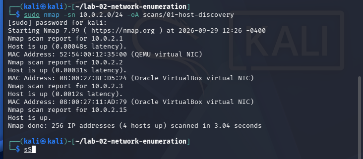
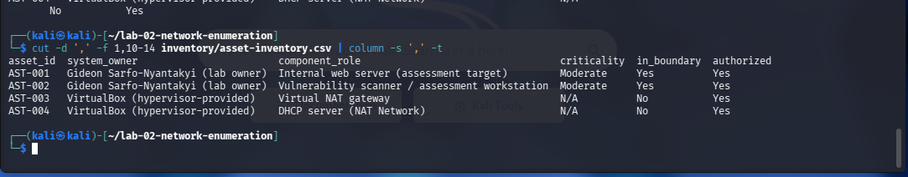

# Lab 02 — Network Enumeration & System Component Inventory

**NIST SP 800-53 Rev. 5:** CM-8 System Component Inventory (primary) · CM-7 Least Functionality (secondary) · RA-5 / SI-2 (links to Lab 01)
**Tools:** Nmap 7.99, Python 3, `ss`, `nmcli`, `systemctl`, `timedatectl`, Kali Linux, Oracle VirtualBox
**Author:** Gideon Sarfo-Nyantakyi · CompTIA Security+ CE · Active DoD Secret clearance

> ⚠️ All scanning was performed inside an isolated personal lab network that I own and control. No external or third-party systems were scanned, and no exploitation was performed.

---

## Executive Summary

I built an isolated two-VM lab network and performed a CM-8 component inventory and CM-7 least-functionality assessment. Network discovery found 4 live components. Only 1 of the 4 appeared in the detailed scan output; a complete inventory required host-based verification and investigation of an initially unidentified device, which I confirmed as the hypervisor's DHCP server. The target web server exposed **30 open TCP services, 28 of which were not in the authorized baseline** (SSH and HTTP only), including a root backdoor and known-trojaned service versions. A host-based check of the scanner also found an undocumented AI model server running at boot, which I investigated, disabled, and verified across a reboot. All findings are tracked in a 9-item POA&M (1 Critical, 3 High, 3 Moderate, 2 Low); 2 items on the scanner are closed with verified evidence.

---

## 1. Objective

An organization can't secure what it doesn't know it has. **CM-8** requires an accurate, documented inventory of every component within the authorization boundary, at a level of detail sufficient for tracking and accountability, reviewed on a defined schedule. **CM-7** requires systems to provide only mission-essential capabilities and to prohibit unneeded ports, protocols, and services.

This lab:
1. Discovers every live component on the lab network
2. Records each component's OS, open ports, and service versions
3. Converts scan output into a governance-ready inventory (owner, role, criticality, boundary, authorization)
4. Compares running services against an authorized baseline and tracks deviations in a POA&M

## 2. Rules of Engagement

| Item | Value |
|---|---|
| Authorized scope | 10.0.2.0/24 (VirtualBox NAT Network "GRC-Lab", isolated lab network) |
| Out of scope | Windows host machine; home network including router/DNS server 192.168.1.1; all internet addresses; MemForensicsLab VM (present on the host, not attached to GRC-Lab) |
| Scanner | Kali Linux VM, 10.0.2.15 (MAC 08:00:27:A1:6F:47) |
| Scan window | 2026-09-29 — host discovery 12:26:02–12:26:05; inventory scan 12:52:58–14:45:12 (UTC-4 per scanner clock at the time, i.e. 11:26 and 11:52–13:45 CDT local; scanner was not time-synchronized, see POA&M-012). Host-based checks 2026-09-29 and 2026-09-30. |
| Authorization | Self-authorized by Gideon Sarfo-Nyantakyi as lab owner and operator |
| Constraints | Discovery and enumeration only; no exploitation or credential attacks |

## 3. Lab Environment

| VM | Purpose | IP | MAC |
|---|---|---|---|
| Kali Linux | Scanner / assessment workstation | 10.0.2.15 | 08:00:27:A1:6F:47 |
| Metasploitable2 | Assessment target (fictional role: internal web server) | 10.0.2.3 | 08:00:27:11:AD:79 |

- **Network:** VirtualBox NAT Network "GRC-Lab", 10.0.2.0/24, DHCP enabled, IPv6 disabled
- **Host:** Windows workstation running Oracle VirtualBox 7
- **Target source:** Metasploitable 2 obtained from Rapid7's official SourceForge project (supply chain: verified publisher)
- **Baselines:** Snapshots taken of both VMs before assessment (CM-2)
- **External dependency:** DHCP provides the home router (192.168.1.1) as DNS server, giving the lab an outbound path for name resolution. Documented, not scanned.

## 4. Methodology

**Step 1 — Confirm scope.** Verified the scanner's address and route before scanning, and confirmed the target's address and MAC from its own console.
```bash
ip a            # scanner IP and MAC
ip route        # gateway 10.0.2.1; 10.0.2.0/24 directly connected
ping -c 4 10.0.2.3
```

**Step 2 — Host discovery.** ARP-based ping sweep of the authorized range; no ports scanned.
```bash
sudo nmap -sn 10.0.2.0/24 -oA scans/01-host-discovery
```
Result: 4 hosts up. An unrecognized VirtualBox-MAC device at 10.0.2.2 was investigated and identified as the NAT Network DHCP server:
```bash
nmcli -f DHCP4 device show eth0 | grep -i server   # dhcp_server_identifier = 10.0.2.2
```

**Step 3 — Boundary decision and inventory scan.** Hypervisor-provided components (gateway, DHCP server) were documented as out of boundary. The two in-boundary hosts were placed in an approved target list and fully scanned: all 65,535 TCP ports, with service version and OS detection.
```bash
printf "10.0.2.3\n10.0.2.15\n" > scans/in-boundary-hosts.txt
sudo nmap -sS -sV -O -p- --open -T4 -iL scans/in-boundary-hosts.txt -oA scans/02-inventory-scan
```
The scan took ~1h52m because Metasploitable's legacy TCP stack rate-limits responses. A two-phase approach (fast port discovery with `--min-rate`, then version detection on open ports only) would shorten this in a time-constrained assessment.

**Step 3a — Host-based verification of the scanner.** Kali did not appear in the scan output (`--open` hides hosts with no open ports), and scanning the scanner's own IP over the network proved unreliable. Listening services were checked from inside the host instead:
```bash
sudo ss -tulpn
```

**Step 4 — Build the inventory.** A Python script converts the Nmap XML into CSV inventories and compares every open service against the authorized ports/protocols/services baseline.
```bash
python3 nmap_to_inventory.py scans/02-inventory-scan.xml -o inventory -b authorized-baseline.csv
```
Output was validated against the raw report: 30 open services read, 28 flagged.

**Step 5 — Governance review.** As system owner, I assigned owner, role, criticality, boundary status, and authorization to each component, and added the components the scan could not list (scanner, gateway, DHCP server). Decisions are recorded reproducibly in `step5_governance.py`. Findings were grouped by shared cause and remediation into POA&M items and prioritized by risk.

## 5. Results

| Metric | Result |
|---|---|
| Live hosts discovered | 4 |
| Components in authorization boundary | 2 |
| Components out of boundary (documented, not assessed) | 2 |
| Components listed by the automated scan | 1 of 4 |
| Open TCP services — Metasploitable | 30 |
| Open TCP services — Kali (network-exposed) | 0 |
| Services not in authorized baseline | 28 |
| Localhost-only services on Kali | 1 (Ollama), 0 after remediation |
| POA&M items | 9 (1 Critical, 3 High, 3 Moderate, 2 Low) — 2 closed |

**Final asset inventory:** [`inventory/asset-inventory.csv`](inventory/asset-inventory.csv)
**Service inventory:** [`inventory/service-inventory.csv`](inventory/service-inventory.csv)
**Unauthorized services (CM-7):** [`inventory/unauthorized-services.csv`](inventory/unauthorized-services.csv)
**Authorized baseline:** [`authorized-baseline.csv`](authorized-baseline.csv)




## 6. Findings & POA&M Entries

| POA&M ID | Control | Weakness | Asset | Risk | Remediation | Milestone | Status |
|---|---|---|---|---|---|---|---|
| POA&M-004 | CM-7, CM-11, SI-2 | Undocumented AI model server (Ollama) manually installed outside the package manager, running as an auto-start service; no business need identified; not covered by apt updates | Kali scanner (10.0.2.15) | Low | Service stopped and disabled from boot (`systemctl disable --now ollama`); binary and model retained pending removal decision | 2026-09-29 | Completed |
| POA&M-005 | CM-7, SR-11, IR-4 | Backdoored/compromised services: bindshell root shell (1524), vsftpd 2.3.4 (21), UnrealIRCd (6667, 6697) | Metasploitable (10.0.2.3) | Critical | Isolate host; treat as compromised; remove services and rebuild from trusted media | 2026-10-01 | Open |
| POA&M-006 | CM-7, SC-8 | Cleartext remote access: Telnet (23), rexec/rlogin/rsh (512-514), VNC 3.3 (5900) | Metasploitable (10.0.2.3) | High | Disable all; use SSH (22) as the sole remote administration method | 2026-10-30 | Open |
| POA&M-007 | CM-7, AC-3, SC-8 | Unneeded file sharing/transfer: ProFTPD (2121), Samba (139, 445), NFS and RPC helpers (111, 2049, 33206, 42405, 49384) | Metasploitable (10.0.2.3) | High | Disable services; if file sharing is later required, document justification and use encrypted methods | 2026-10-30 | Open |
| POA&M-008 | CM-7 | Remote code/development services: distccd (3632), Java RMI (1099, 35730), Ruby DRb (8787), X11 (6000) | Metasploitable (10.0.2.3) | High | Disable and remove; no mission need for a web server | 2026-10-30 | Open |
| POA&M-009 | CM-7, SC-7 | Databases reachable from the network: MySQL (3306), PostgreSQL (5432) | Metasploitable (10.0.2.3) | Moderate | Bind to localhost or remove; restrict any required access with host firewall | 2026-12-29 | Open |
| POA&M-010 | CM-7 | Unneeded server roles: SMTP (25), DNS (53), Apache JServ/AJP (8009), Tomcat (8180) | Metasploitable (10.0.2.3) | Moderate | Disable services not required for the web server role | 2026-12-29 | Open |
| POA&M-011 | SI-2, RA-5 | Outdated authorized services: OpenSSH 4.7p1 (22), Apache 2.2.8 (80) | Metasploitable (10.0.2.3) | Moderate | Upgrade to supported versions; re-scan to verify | 2026-12-29 | Open |
| POA&M-012 | SC-45, AU-8 | Scanner clock not synchronized to an authoritative time source (NTP inactive); time zone set to America/New_York rather than local time; hardware clock ~20 min behind system clock | Kali scanner (10.0.2.15) | Low | Set local time zone and enable NTP (`timedatectl set-timezone America/Chicago`, `timedatectl set-ntp true`); verify with `timedatectl` | 2026-09-30 | Completed |

#### POA&M-004 Details
- **How found:** Host-based listening-port check (`ss -tulpn`). Not visible to the network scan because the service was bound to localhost (127.0.0.1:11434).
- **Investigation:** Binary at `/usr/local/bin/ollama` (manual install, root-owned, file dated Jun 26); Phi-2 model (1.6 GB) downloaded ~3 months prior; service consuming ~300 MB RAM at idle.
- **Residual risk:** Software remains installed and could be re-enabled. The service has no authentication; if re-enabled with a non-localhost binding, it would be exposed to the network.
- **Closure evidence:** Follow-up `ss -tulpn` showed no listener. Screenshots 05, 09-11.
- **Persistence verified:** After a full reboot (2026-09-30), `ss -tulpn` showed no listening services. Screenshot 13.

#### POA&M-005 to POA&M-011 Notes
- **Source:** Nmap full TCP scan compared against `authorized-baseline.csv` (web server role: SSH and HTTP only). Full list in `inventory/unauthorized-services.csv`.
- **Grouping:** 28 unauthorized services grouped by shared cause and remediation. POA&M-011 is tracked separately because those services are authorized but outdated (patching, not least functionality).
- **Evidence limits:** Backdoor findings are based on identified versions and published documentation for this system. No exploitation was performed, as it is outside the Rules of Engagement.
- **Context:** Metasploitable is intentionally vulnerable. Remediation is planned for a follow-on hardening lab with a before-and-after re-scan.

#### POA&M-012 Details
- **How found:** While recording the scan window, Nmap timestamps showed a UTC-4 offset, inconsistent with the lab's local time zone. `timedatectl` confirmed the time zone setting, NTP inactive, and clock not synchronized.
- **Impact on this assessment:** Recorded timestamps include their UTC offset and remain unambiguous, but their accuracy cannot be proven against an authoritative time source.
- **Clock accuracy check (2026-09-30):** Scanner time matched the Windows host clock after adjusting for time zone. Clock was accurate, but nothing kept it synchronized.
- **Remediation deferred** until the scan window was documented, so existing evidence stayed consistent. Screenshot 15.
- **Remediated 2026-09-30:** Time zone set to America/Chicago and NTP enabled; `timedatectl` confirmed the clock synchronized and the hardware clock aligned. Screenshot 16.

## 7. Control Implementation Statements (SSP-style)

**CM-8 System Component Inventory**
> The lab system maintains a component inventory (`inventory/asset-inventory.csv`) built from active network discovery with Nmap, host-based verification of listening services, and manual review by the system owner. For each component, the inventory records asset ID, IP address, MAC address, hostname, operating system, open services, system owner, component role, criticality, authorization boundary status, authorization status, and date last verified. Components are tracked by MAC address because IP addresses are assigned by DHCP. Components outside the authorization boundary are documented but not assessed. The inventory is reviewed monthly and whenever components are added, removed, or reconfigured.

**CM-7 Least Functionality**
> Authorized ports, protocols, and services are defined per component in `authorized-baseline.csv`, each with a documented justification. Open services identified by scanning are compared against this baseline, and any service not in the baseline is recorded as a finding and tracked to remediation in the POA&M.

## 8. Lessons Learned

- **Automated discovery is where an inventory starts, not where it ends.** The scan listed 1 of 4 components. A complete inventory needed network scanning, host-based checks, and investigation of an unidentified device.
- **Absence of output is not absence of a host.** `--open` hid the scanner entirely because it had no open ports. The host count ("2 hosts up") exposed the gap.
- **Network and host views are complementary.** The network scan could never have found Ollama because it listened only on localhost; the host-based check did.
- **Localhost binding was the only control protecting an unauthenticated service.** One configuration change would have exposed it to the network.
- **Scanning the scanner over the network is unreliable.** Probes and replies take different internal paths; checking from inside the host is faster and authoritative.
- **No single source gets every field.** Hostnames were blank (no DNS in the lab) and were verified from the target's login prompt and Nmap service info.
- **Thoroughness has a cost.** The full-port scan took ~1h52m against a legacy TCP stack. In production, scan settings must balance completeness against time and operational impact.
- **Timestamps are evidence too.** Checking the scan window uncovered an unsynchronized clock and wrong time zone on the scanner (POA&M-012).
- **IPv4 scope does not mean IPv6 is absent.** Both VMs auto-configured IPv6 link-local addresses. Production inventory and monitoring must cover both address families.

## 9. Limitations

- UDP services were not network-scanned due to time constraints; host-based checks covered UDP on the scanner only.
- No credentialed (logged-in) assessment of the target; software not exposed to the network was not inventoried on Metasploitable.
- OS identification is fingerprint-based (Linux 2.6.9–2.6.33) and not host-verified.
- Findings reflect a single point in time.

## 10. Next Lab

**Lab 03:** Hardening and configuration settings (CM-6) — remediate POA&M items on the target, then re-scan to verify a before-and-after reduction in exposed services.

---

### Evidence Index

| # | Screenshot | Shows |
|---|---|---|
| 01 | `01-scope-verification-a.png`, `-b.png` | Scanner IP, route, and connectivity to target |
| 02 | `02-host-discovery.png` | 4 hosts discovered |
| 03 | `03-dhcp-server-verification.png` | Unknown device identified as DHCP server |
| 04 | `04-inventory-scan-p1.png`, `-p2.png` | Full scan results for the target |
| 05 | `05-kali-host-based-check.png` | Ollama listening on localhost |
| 06 | `06-authorized-baseline.png` | Approved ports/protocols/services |
| 07 | `07-unauthorized-services.png` | 28 services not in baseline |
| 08 | `08-asset-inventory.png` | Scanner-generated inventory (1 component) |
| 09–10 | `09-`, `10-ollama-investigation-*.png` | Binary location, model, timeline |
| 11 | `11-ollama-status-disable-verify.png` | Service status, disable command, and follow-up `ss` check (one screenshot) |
| 13 | `13-ollama-persistence-check.png` | No listeners after reboot |
| 14 | `14-final-asset-inventory-a.png`, `-b.png` | Completed inventory (4 components) |
| 15 | `15-time-sync-check.png` | `timedatectl` output for POA&M-012 |
| 16 | `16-time-sync-remediated.png` | Time zone corrected, NTP active, clock synchronized |

### Repo Contents
```
lab-02-network-enumeration/
├── README.md
├── nmap_to_inventory.py       # Nmap XML → CM-8 inventory + CM-7 baseline check
├── step5_governance.py        # System owner decisions recorded in the inventory
├── authorized-baseline.csv    # Approved ports/protocols/services
├── scans/                     # Raw Nmap output (.nmap, .gnmap, .xml) and target list
├── inventory/                 # Asset, service, and unauthorized-service CSVs
└── screenshots/
```
