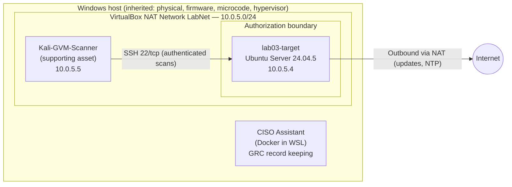

# System Security Plan — lab03-target

| Field | Entry |
|---|---|
| System name | lab03-target |
| System ID | SYS-001 |
| SSP version | 1.0 (initial) |
| SSP date | 2026-10-19 |
| Prepared by | Gideon Sarfo-Nyantakyi (@Gracekid), System Owner / Security Analyst |
| Security categorization | **Low** (FIPS 199: Confidentiality Low, Integrity Low, Availability Low) |
| Operational status | Operational |
| Control baseline | NIST SP 800-53 Rev 5, tailored (23 controls) |
| Assessment record | CISO Assistant audit ASMT-001, "SSP Assessment – lab03-target – Oct 2026" |

## 1. Executive summary

`lab03-target` is a hardened Ubuntu Server 24.04.5 LTS virtual machine used as the system under assessment in a personal RMF/GRC homelab. It was hardened to the CIS Level 1 Server benchmark in Lab 03 and assessed in Lab 04 against a tailored set of 23 NIST SP 800-53 Rev 5 controls in CISO Assistant.

| Result | Controls | Share |
|---|---|---|
| Implemented | 14 | 61% |
| Partially implemented | 8 | 35% |
| Planned (not implemented) | 1 | 4% |

All 9 gaps are tracked in the POA&M (Section 12). There are no Critical or High vulnerability findings; the two Medium findings are inherited from the host platform and risk-accepted.

## 2. System description and purpose

The system exists to demonstrate the full RMF lifecycle on a single host: secure configuration (Lab 03), vulnerability scanning (Labs 01 and 03), documentation and assessment (this SSP), and continuous monitoring (Lab 05, planned). It runs only OpenSSH for administration and holds no production, personal, or controlled unclassified information.

**Users.** Two accounts are authorized for interactive access:

| Account | Role | Access method |
|---|---|---|
| `gsarfo` | System administrator | Console; SSH from LabNet |
| `gvmscan` | Dedicated vulnerability-scan account, used only by GVM | SSH from the Kali scanner |

**Roles and responsibilities.** In this lab one person holds all roles. In a production program these would be separate people.

| Role | Holder | Responsibility |
|---|---|---|
| System Owner / Authorizing Official (simulated) | @Gracekid | Approves baseline deviations and risk acceptances |
| System Administrator | @Gracekid | Applies configurations and patches |
| Security Analyst / Assessor | @Gracekid | Runs scans, maintains the POA&M, writes this SSP |

## 3. Security categorization (FIPS 199)

| Objective | Impact | Justification |
|---|---|---|
| Confidentiality | Low | The system stores only lab configuration and assessment data. No PII, CUI, credentials of real services, or production data. Disclosure would have limited adverse effect. |
| Integrity | Low | Unauthorized modification would invalidate lab results but cause no harm outside the lab. The system can be rebuilt from snapshots and documented baselines. |
| Availability | Low | No mission or business function depends on the system. Recovery objectives (Section 9) allow a 72-hour maximum tolerable downtime. |

**Overall categorization: Low.** The tailored control set (Section 7) starts from the 800-53 Low baseline.

## 4. Authorization boundary

The boundary contains one system, `lab03-target`. The Kali scanner is a supporting asset that connects into the boundary but is outside it.

**Out of scope:** Metasploitable2, MemForensicsLab, the Windows host operating system, and the CISO Assistant platform. Their findings are tracked in a master POA&M, not in this SSP.

## 5. System inventory (CM-8)

| Asset ID | Component | Detail |
|---|---|---|
| AST-001 | lab03-target (primary) | VirtualBox VM, 2 vCPU, 1024 MB RAM (reduced from 2048 MB to fit the 8 GB host), 25 GB disk, legacy BIOS, LVM, no disk encryption |
| | Operating system | Ubuntu Server 24.04.5 LTS, kernel 6.8.0-146-generic |
| | Key software | OpenSSH server, ufw, AppArmor, AIDE, rsyslog, systemd-journald, unattended-upgrades, Postfix (AIDE dependency, loopback only), OpenSCAP 1.3.9 |
| AST-002 | Kali-GVM-Scanner (supporting) | Kali Linux 2026.2 VM, 3 vCPU, 4096 MB RAM, GVM 25.04.0 with Greenbone Community Feed; rebuilt 2026-10-15 |

## 6. Ports, protocols, and services

| Port / protocol | Service | Exposure | Justification |
|---|---|---|---|
| 22/tcp | OpenSSH | Allowed inbound from 10.0.5.0/24 only (ufw) | Sole remote administration method; required for authenticated scanning |
| 25/tcp | Postfix | Loopback only (127.0.0.1, ::1) | Installed as an AIDE dependency for local mail; no network exposure |
| Outbound (all) | Updates, NTP, DNS | Allowed by default | Required for patching and time sync; default-allow is a known gap (POA&M-013) |

One listening port lacks a matching firewall rule, most likely SSH on IPv6 (POA&M-014).

**Interconnections.** No system-to-system interconnections. Outbound internet access goes through VirtualBox NAT. **Inherited controls** come from the host platform: physical protection, CPU microcode, firmware, and hypervisor isolation (relevant to SC-39 and the risk-accepted CPU findings).

## 7. Control selection and tailoring

The starting point was the NIST SP 800-53 Rev 5 Low baseline. It was tailored to the 23 controls for which Labs 01–04 produced direct evidence. All other 800-53 requirements (1,166 of 1,189 in CISO Assistant) are outside this lab's tailored scope and were not assessed.

**Tailoring decisions:**

- **Policy and procedure controls (the "-1" controls) are excluded.** A single-person lab has no organizational policy layer to assess. The Configuration Baseline Standard in Lab 03 partly addresses CM-1.
- **Enhancements are recorded in statements, not assessed separately.** IA-2(1) (MFA for privileged accounts, part of the Low baseline) and RA-5(5) (privileged access scanning) are covered in the base-control statements and the POA&M.
- **Physical and environmental (PE) and personnel (PS) controls** are inherited from the host or not applicable to a VM in a home lab.
- **CP-10 is included** even though it is not implemented, because Lab 03 showed a real recovery gap.

## 8. Control implementation statements

Results come from CISO Assistant audit ASMT-001. The full matrix with evidence links is in `control-matrix.csv`.

### Access Control (AC)

**AC-2 Account Management — Partially implemented.**
`lab03-target` has two interactive accounts: `gsarfo` (system administrator) and `gvmscan` (dedicated scan account used only by GVM). Each account has a single documented purpose and is explicitly listed in the SSH `AllowUsers` directive. Inactive accounts are handled through periodic account review in place of password-expiry disablement (see the password-aging risk acceptance). *Gap:* no documented emergency or break-glass account or recovery procedure, and account review is not yet recorded on a schedule. → POA&M-019

**AC-3 Access Enforcement — Implemented.**
Boot-time access is enforced by a GRUB superuser (`grubadmin`) with a PBKDF2-hashed password: normal boot is unrestricted, but editing boot entries requires the password, and recovery entries are disabled. AppArmor is enabled at boot. sudo access is restricted, and `secure_path` excludes `/snap/bin`. AppArmor profiles not in enforce or complain mode are tracked separately. → POA&M-015

**AC-6 Least Privilege — Implemented.**
Root login over SSH is disabled; administrative actions require sudo by the named administrator. The `gvmscan` account exists only for authenticated scanning and is not used interactively. sudo `secure_path` was restricted in `/etc/sudoers.d/10-secure-path` and validated with `visudo -c`. A stricter default umask prevents root-created files from being readable by other users.

**AC-7 Unsuccessful Logon Attempts — Implemented.**
`pam_faillock` locks an account after 4 consecutive failed authentication attempts, including mistyped sudo passwords. SSH limits authentication attempts per connection and applies login delays. Effectiveness was demonstrated when the administrator account locked and needed `faillock --reset`, and when the GVM default-credential brute-force check timed out against the hardened service.

**AC-8 System Use Notification — Implemented.**
A system use banner ("Authorized users only. All activity may be monitored and reported.") is displayed before SSH authentication and at local login. It was applied by the CIS Level 1 remediation script and verified during second-session SSH testing.

**AC-12 Session Termination — Implemented.**
Idle SSH sessions are terminated after approximately 15 minutes of inactivity through `ClientAliveInterval` and `ClientAliveCountMax` in the hardened sshd configuration.

**AC-17 Remote Access — Implemented.**
Remote administration is permitted only over SSH. ufw allows SSH only from the LabNet subnet 10.0.5.0/24. `AllowUsers` restricts SSH to `gsarfo` and `gvmscan`, root login is disabled, empty passwords are rejected, and SSH is limited to hardened ciphers, MACs, and key-exchange algorithms. The host ED25519 key fingerprint was verified on first connection. → POA&M-014 (IPv6 rule)

### Audit and Accountability (AU)

**AU-2 Event Logging — Partially implemented.**
System logging is provided by systemd-journald and rsyslog (both verified active 2026-10-19), configured to CIS Level 1 Server requirements including sudo logging. Log file permissions under `/var/log` were corrected and verified. The Linux audit daemon (auditd) is not active: its rules fall under CIS Level 2, outside the approved Level 1 baseline. Logs are kept locally only. *Gap:* no auditd event auditing, no centralized log collection, and no defined review process. → POA&M-021

**AU-12 Audit Record Generation — Partially implemented.**
journald and rsyslog generate records for authentication, sudo use, and system services. *Gap:* with auditd inactive, kernel-level events such as file access and privileged command execution are not recorded, and records are not forwarded to a central collector or correlated. → POA&M-021

### Assessment, Authorization, and Monitoring (CA)

**CA-5 Plan of Action and Milestones — Implemented.**
A POA&M is maintained across Labs 01–04 with sequential IDs, weakness, mapped control, severity, planned action, scheduled completion, and status. Items close only with evidence; for example, POA&M-002 closed on 2026-10-16 with the authenticated scan, and POA&M-022 closed on 2026-10-19 with `timedatectl` output.

**CA-7 Continuous Monitoring — Partially implemented.**
The Configuration Baseline Standard requires a scan against the tailored profile before entering service, after any significant change, and at least monthly. Evidence records in CISO Assistant carry expiry dates matching that cadence. A find-fix-verify cycle was shown with a GVM rescan and delta report. *Gap:* monitoring is manual and point-in-time, with no automated scheduled scans or log monitoring. → POA&M-021

### Configuration Management (CM)

**CM-2 Baseline Configuration — Implemented.**
The approved baseline is the CIS Ubuntu Linux 24.04 LTS Benchmark v1.0.0, Level 1 – Server, delivered through SCAP Security Guide 0.1.82 and tailored in `lab03-tailoring.xml` (profile `lab03_cis_l1_server_tailored`). Snapshots preserve the pre-hardening and pre-remediation states.

**CM-6 Configuration Settings — Implemented.**
Settings were applied with a reviewed 398-fix remediation script plus manual fixes, raising the OpenSCAP score from 68.83 to 97.58 against the tailored profile. All 112 baseline failures are dispositioned: 102 remediated, 7 not applicable, 3 risk-accepted. Each deviation is recorded in the deviation register with a justification. → POA&M-013, -014, -015

**CM-7 Least Functionality — Partially implemented.**
Unused kernel modules and filesystems are disabled, cleartext client packages are removed, and `/tmp` is mounted `noexec,nosuid,nodev`. Postfix listens on loopback only. *Gap:* some AppArmor profiles are not in enforce or complain mode. → POA&M-015

**CM-8 System Component Inventory — Implemented.**
Components are inventoried from the Lab 02 network enumeration and recorded in CISO Assistant as AST-001 (`lab03-target`, primary) and AST-002 (Kali-GVM-Scanner, supporting), with hardware, OS, kernel, and network attributes in Section 5.

### Contingency Planning (CP)

**CP-10 System Recovery and Reconstitution — Planned (not implemented).**
Recovery objectives are defined (RTO 24 h, RPO 24 h, MTD 72 h), and VM snapshots exist. *Gap:* no documented and tested break-glass and recovery procedure. During Lab 03, recovery needed rescue media after the only administrator was locked out by controls working as designed (AC-7 lockout plus the GRUB password). → POA&M-019

### Identification and Authentication (IA)

**IA-2 Identification and Authentication (Organizational Users) — Partially implemented.**
Each user authenticates with a unique named account; shared and root SSH logins are not permitted. *Gap:* SSH uses password authentication without multi-factor authentication for the privileged account, which the Low baseline requires under IA-2(1). → POA&M-020

**IA-5 Authenticator Management — Implemented.**
`pam_pwquality` enforces a minimum length of 14 with quality checks, and `pam_pwhistory` prevents reuse. Periodic forced expiration is not enforced, following NIST SP 800-63B and a documented risk acceptance (review 2027-10-07); passwords change on evidence of compromise. The GVM application password policy on the supporting asset is tracked separately. → POA&M-018

### Risk Assessment (RA)

**RA-3 Risk Assessment — Partially implemented.**
Risks are assessed per finding, with likelihood and impact, in two risk acceptance memos (password aging; inherited CPU mitigations). *Gap:* no system-level risk register yet. Planned as a CISO Assistant risk assessment for this perimeter.

**RA-5 Vulnerability Monitoring and Scanning — Implemented.**
Scanning uses GVM with the Greenbone Community Feed from a dedicated Kali scanner. An authenticated scan over SSH as `gvmscan` on 2026-10-16 found 0 Critical, 0 High, 2 Medium, 1 Low. The Low finding was remediated and confirmed gone by rescan and delta report. Authentication success is evidenced by the "SSH Login Successful For Authenticated Checks" result, satisfying RA-5(5). → POA&M-016, -017

### System and Communications Protection (SC)

**SC-7 Boundary Protection — Partially implemented.**
`lab03-target` is on the isolated VirtualBox NAT Network LabNet (10.0.5.0/24). ufw is active with default-deny inbound and SSH allowed only from 10.0.5.0/24; hardened kernel network parameters are applied and TCP timestamps are disabled. *Gaps:* outbound traffic is allowed by default, and one listening port (likely SSH on IPv6) has no matching rule. → POA&M-013, -014

### System and Information Integrity (SI)

**SI-2 Flaw Remediation — Implemented.**
The OS was fully patched before rescan (35 pending security updates reduced to 0) and verified by rescan. Automatic security updates are enabled through unattended-upgrades (service enabled; `APT::Periodic::Update-Package-Lists` and `Unattended-Upgrade` set to 1, verified 2026-10-19). Two Medium CPU-mitigation findings are inherited from host firmware and VirtualBox and are risk-accepted with compensating controls (review 2027-04-16). *Operational limitation:* unattended-upgrades runs only while the VM is powered on, so patch currency depends on the VM being started regularly (the 2026-10-19 login showed package lists more than a week old). → POA&M-016, -017

**SI-7 Software, Firmware, and Information Integrity — Implemented.**
AIDE file integrity monitoring is installed and initialized with a baseline database under the CIS Level 1 baseline.

## 9. Contingency objectives

| Objective | Target | Basis |
|---|---|---|
| Recovery Time Objective (RTO) | 24 hours | Restore from VM snapshot or rebuild from the documented baseline |
| Recovery Point Objective (RPO) | 24 hours | At most one day of configuration changes lost |
| Maximum Tolerable Downtime (MTD) | 72 hours | No dependent mission function; Low availability impact |

These objectives are defined but not yet backed by a tested recovery procedure (CP-10, POA&M-019).

## 10. Continuous monitoring strategy

| Activity | Frequency | Tool | Status |
|---|---|---|---|
| Configuration compliance scan (tailored CIS L1) | Monthly and after significant change | OpenSCAP | Defined; manual |
| Authenticated vulnerability scan | Monthly and after significant change | GVM | Defined; manual |
| POA&M review | Monthly | GitHub / CISO Assistant | Active |
| Evidence freshness | Evidence records expire 30 days after the scan | CISO Assistant | Active |
| Log collection and review | Planned | Lab 05 | Not implemented (POA&M-021) |
| Scanner time synchronization check | Before each scan | `timedatectl` | Added 2026-10-19 (POA&M-022) |

## 11. Risk acceptances

| Risk | Decision | Approved by | Review date |
|---|---|---|---|
| No periodic password expiration (3 CIS rules) | Accepted per NIST SP 800-63B, with compensating controls (length 14+, reuse prevention, lockout, `AllowUsers`, account review) | System Owner | 2027-10-07 |
| Missing CPU mitigations: MMIO Stale Data and Speculative Store Bypass (5.5 Medium each) | Accepted as inherited from host microcode and hypervisor, with compensating controls (host patching, no untrusted code, network isolation) | System Owner | 2027-04-16 |

Full memos are in the Lab 03 README.

## 12. Plan of Action and Milestones

| ID | Weakness | Control | Severity | Planned action | Scheduled | Status |
|---|---|---|---|---|---|---|
| POA&M-013 | ufw allows all outbound traffic by default | SC-7(5) | Medium | Build an egress allow-list (DNS, NTP, HTTP/HTTPS), test, then default-deny outbound | 2026-11-30 | Open |
| POA&M-014 | Listening port without a firewall rule (likely SSH on IPv6) | SC-7 | Medium | Confirm with `ss -tlnp`; bind SSH to IPv4 or add an IPv6 rule; rescan | 2026-11-15 | Open |
| POA&M-015 | Some AppArmor profiles not in enforce or complain mode | AC-3(3), CM-7 | Medium | Identify with `aa-status`; test complain mode or document as a deviation | 2026-11-30 | Open |
| POA&M-016 | Missing kernel mitigation: MMIO Stale Data (inherited) | SI-2, SC-39 | Medium | Keep host firmware, microcode, VirtualBox current; rescan after changes | 2027-04-16 | Risk accepted |
| POA&M-017 | Missing kernel mitigation: Speculative Store Bypass (inherited) | SI-2, SC-39 | Medium | As POA&M-016 | 2027-04-16 | Risk accepted |
| POA&M-018 | GVM password policy empty (supporting asset) | IA-5(1) | Low | Configure `/etc/gvm/pwpolicy.conf`; change the GVM admin password | 2026-11-15 | Open |
| POA&M-019 | No documented break-glass or recovery procedure | CP-10, AC-2 | Medium | Write and test a recovery runbook (GRUB password escrow, emergency account, rescue ISO) | 2026-11-30 | Open |
| POA&M-020 | No MFA for privileged SSH access | IA-2(1) | Medium | Require SSH key plus password, or key plus TOTP, for `gsarfo`; keep `gvmscan` key-only | 2026-11-30 | Open |
| POA&M-021 | No auditd, centralized log collection, or log review | AU-2, AU-12, CA-7 | Medium | Lab 05: deploy log collection and analysis, define review cadence, evaluate auditd | Lab 05 | Open |
| POA&M-022 | Rebuilt scanner reverted to America/New_York with NTP inactive (POA&M-012 fix lost in rebuild) | AU-8, CM-2 | Low | Set time zone to America/Chicago and enable NTP; verify with `timedatectl` | 2026-10-19 | **Closed 2026-10-19** |

## 13. Assessment limitations

- **Self-assessment.** The same person built, assessed, and approved the system. A real authorization requires an independent assessor (CA-2(1)).
- **Tailored scope.** 23 of 1,189 requirements were assessed. Results describe the tailored set only, not 800-53 compliance overall.
- **Scan timestamps.** The 2026-10-16 GVM scans ran while the scanner was set to Eastern time with NTP inactive (POA&M-022). GVM reports and the Lab 03 README record UTC scan windows, so the evidence remains unambiguous, but clock accuracy at scan time cannot be proven against an authoritative source.
- **Evidence age.** Scan evidence dates from 2026-10-16 and expires for monitoring purposes on 2026-11-16.

## 14. Lessons learned

- **Rebuilding a system can undo its remediations.** The time-sync fix from POA&M-012 was lost when the Kali scanner was rebuilt from a fresh image. Supporting assets need their own documented baseline so that a rebuild returns them to a known-good state.
- **Assessment status and control status are different things.** CP-10's assessment is complete (Done) even though the control is not implemented (Non compliant). The gap belongs in the POA&M, not in an unfinished assessment.
- **Tailoring is a documented decision, not an omission.** Leaving 1,166 requirements unassessed is defensible only because Section 7 explains why.
- **Inherited controls need an owner.** The CPU findings cannot be fixed inside the guest; recognizing inherited responsibility keeps them from being chased as system defects.

## 15. Evidence index

| Evidence record (CISO Assistant) | Location | Supports |
|---|---|---|
| Lab 03 OpenSCAP reports & tailoring | `03-Secure-Configuration-Baseline/evidence/` | AC-3, AC-6, AC-8, AC-12, AC-17, AU-2, AU-12, CM-2, CM-6, CM-7, SC-7, SI-2, SI-7 |
| Lab 03 GVM authenticated scans | `03-Secure-Configuration-Baseline/evidence/` | AC-7, CA-7, RA-5, SI-2 |
| Lab 03 hardening screenshots (05–09) | `03-Secure-Configuration-Baseline/evidence/` | AC-2, AC-3, AC-6, AC-7, AC-17, IA-2, IA-5, SC-7 |
| Lab 03 risk acceptance | `03-Secure-Configuration-Baseline/README.md` | AC-2, CA-5, IA-5, RA-3, SI-2 |
| Lab 02 asset inventory | `02-Network-Enumeration/` | CA-5, CM-8 |
| Lab 04 logging & patching check | `04-System-Security-Plan/evidence/lab04-01-logging-patching.png` | AU-2, AU-12, SI-2 |
| Kali time-sync fix | `04-System-Security-Plan/evidence/lab04-02-kali-time-sync.png` | POA&M-022 |
| CISO Assistant setup and results | `04-System-Security-Plan/evidence/step1a–1e, step3-audit-results.png` | CM-8, CA-5 |
| CISO Assistant audit export (23 assessed controls) | `04-System-Security-Plan/evidence/lab04-ciso-assistant-audit-posture-assessed.pdf` | All assessed controls |

## Revision history

| Version | Date | Author | Change |
|---|---|---|---|
| 1.0 | 2026-10-19 | @Gracekid | Initial SSP from Lab 04 assessment (ASMT-001) |
